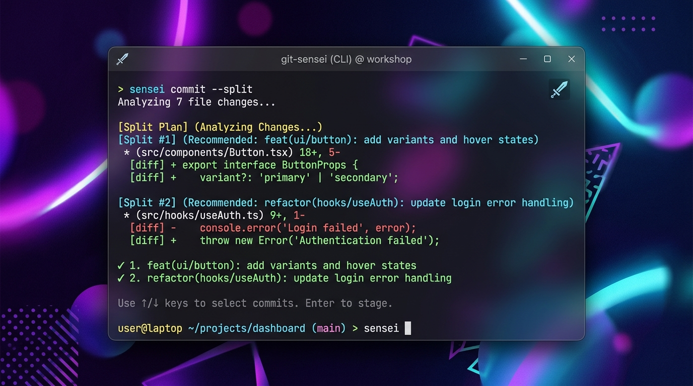

# Git-Sensei

[](https://github.com/Lukasz-Szymanski/git_sensei/actions/workflows/ci.yml)
[](https://pypi.org/project/git-sensei-ai/)
[](https://opensource.org/licenses/MIT)



A CLI tool that generates Conventional Commits messages from staged diffs using local or cloud LLMs (OpenAI, Gemini, Claude, Ollama, or any OpenAI-compatible API).

## Features

- **Multi-Provider Support**: Switch between OpenAI, Google Gemini API, Claude CLI, Ollama, or custom OpenAI-compatible endpoints (DeepSeek, Groq, OpenRouter).
- **Secrets Shield**: Scans staged diffs for API keys, tokens, and credentials before sending anything to an external provider.
- **Smart Context**: Extracts issue IDs (`#42`, `PROJ-123`) and commit types (`feature/` -> `feat`, `fix/` -> `fix`) directly from branch names, with optional GitHub issue context via `gh`.
- **Atomic Commit Splitting**: Groups unrelated changes from a large working tree into separate, logical commits (`sensei commit --split`).
- **PR & Rebase Automation**: Generates pull request descriptions (`sensei pr`) and interactive rebase plans (`sensei squash`).
- **Offline Fallback**: Heuristic diff analyzer when working offline or without API access.
- **Interactive Review**: Approve, regenerate, refine, or edit messages in `$EDITOR` before committing.

## Installation

```bash
pip install git-sensei-ai
```

## Quick Start

```bash
sensei init      # Configure default provider
git add .        # Stage changes
sensei commit    # Generate and review commit message
```

## Commands

| Command | Description |
| :--- | :--- |
| `sensei init` | Interactive setup wizard with connection check |
| `sensei commit` | Generate and create a commit from staged changes |
| `sensei commit --split` | Split staged changes into multiple logical commits |
| `sensei commit -p <name>` | Use a specific provider for this commit |
| `sensei commit -d` | Dry run (preview generated message without committing) |
| `sensei commit --emoji` | Include a Gitmoji prefix |
| `sensei amend` | Rewrite the last commit message |
| `sensei squash` | Generate an interactive rebase plan against a base branch |
| `sensei pr` | Generate a PR description and open a PR via GitHub CLI (`gh`) |
| `sensei use <provider>` | Set the default provider |
| `sensei ls` | List configured providers |
| `sensei check [provider]` | Test connection to a provider |
| `sensei review` | Run AI code review on staged changes (`--strict` for CI) |
| `sensei conflict [file]` | Automatically resolve git merge/rebase conflicts with AI |
| `sensei lint <msg>` | Validate a commit message against Conventional Commits rules |
| `sensei log` | View recent commit history with format compliance indicators |
| `sensei stats` | Show local commit generation statistics |
| `sensei install-hook` | Install as a native `prepare-commit-msg` git hook |

## Git Hooks & Pre-commit

### Native Git Hook

Run `sensei` automatically whenever you invoke `git commit`:

```bash
sensei install-hook
```

### Pre-commit Framework

To lint commit messages with [pre-commit](https://pre-commit.com/), add this to `.pre-commit-config.yaml`:

```yaml
repos:
  - repo: https://github.com/Lukasz-Szymanski/git_sensei
    rev: v0.15.1
    hooks:
      - id: git-sensei-lint
```

Then enable the `commit-msg` hook:

```bash
pre-commit install --hook-type commit-msg
```

## Configuration

Configuration is loaded in the following order of priority:

1. `~/.sensei.toml` (user config)
2. `./.sensei.toml` (repository config)
3. Built-in defaults

### Local Ollama (HTTP API)

```toml
[core]
default_provider = "ollama_api"

[providers.ollama_api]
description = "Local Llama 3 via Ollama API"
api_url = "http://localhost:11434/v1/chat/completions"
model = "llama3"
```

### OpenAI-Compatible Endpoints (DeepSeek, OpenRouter, Groq)

```toml
[providers.deepseek]
description = "DeepSeek API"
api_url = "https://api.deepseek.com/v1/chat/completions"
api_key_env = "DEEPSEEK_API_KEY"
model = "deepseek-chat"
```

### CLI-Based Providers

```toml
[providers.claude]
description = "Claude CLI"
command = "claude --print \"{system}\""
```

## Interactive Review Workflow

```text
Context: Type: feat; Closes issue #42
--------------------------------------------------
feat(auth): add JWT login endpoint

- Add login route with credential validation
- Issue and verify signed JWT tokens
- Protect authenticated routes with middleware

Closes #42
--------------------------------------------------
Action? [y]es, [n]o, [e]dit, [r]etry, re[f]ine, [s]elect type
```

When pressing `e`, Git-Sensei opens your configured editor (`$VISUAL`, `$EDITOR`, or `git config core.editor`).

## Project Structure

```text
src/git_sensei/
├── main.py             # CLI entrypoint and command handlers
├── config.py           # TOML configuration loader
├── constants.py        # Default prompts and branch mappings
├── providers.py        # LLM provider adapters (HTTP & CLI)
├── secrets_shield.py   # Pre-flight regex secret scanner
├── git_utils.py        # Git subprocess wrapper and diff parser
└── core/
    ├── editor.py       # External editor integration
    ├── fallback.py     # Offline heuristic commit generator
    └── stats.py        # Local usage metrics
```

## License

Released under the [MIT License](LICENSE).
